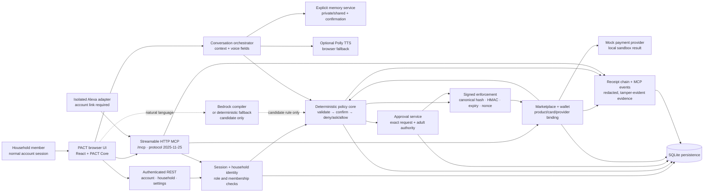

# PACT architecture

PACT is a local, self-hosted household authorization layer for a simulated
Alexa+ add-on experience. The important boundary is intentional: an AI model
may propose a rule or plan, but deterministic application code owns identity,
policy, approval, execution, and evidence.

## System boundary



## Request lifecycle

The verified commerce path is:

```text
Maya: search_catalog
  → get_product
  → check_action
  → request_approval
Siva: get_rules / pending approvals
  → approve
Maya: execute_action
  → get_order_status
  → get_receipts
```

The browser uses REST for authentication, household management, preferences,
wallet administration, and other settings. The marketplace purchase journey
uses authenticated MCP tool calls. Every MCP call is resolved against the
server-issued transport/session identity; tool arguments cannot replace the
authenticated member or household.

## Responsibility map

| Layer | Responsibility | Authority |
|---|---|---|
| Browser UI | Voice/typed interaction, household surfaces, Activity evidence | No authorization authority |
| Conversation orchestrator | Maintains turn context, safe follow-ups, voice-ready summaries, and interruption state | No authorization authority |
| Bedrock compiler | Convert natural language into candidate rule JSON and read-back text | Proposal only |
| Memory service | Store explicit private/shared personalization with confirmation and scope checks | Never policy input |
| Rule schema | Validate fields, roles, thresholds, confirmation state | Code |
| Policy core | Apply precedence, role boundaries, budgets, private routing, and `allow`/`ask`/`deny` | Code |
| Approval service | Require an authorized adult and bind approval to the pending request | Code |
| Token layer | Canonical action hash, HMAC, expiry, nonce replay protection, policy version | Code |
| Marketplace/wallet | Bind product, amount, payment method, merchant, device, and provider | Code |
| Payment provider | Return deterministic simulated provider result | Mock provider |
| Polly adapter | Optional server-side speech audio with browser fallback and safe cache | Presentation only |
| Alexa adapter | Account-linked intent translation into PACT calls | No duplicated policy |
| Receipt/event ledger | Persist execution evidence, hash-chain receipts, and redacted MCP events | Code + SQLite |

## Security properties demonstrated

- A proposed rule is inactive until confirmation.
- Precedence is `deny > ask > allow`; unknown and high-risk actions fail safe.
- A teen can request but cannot approve household actions.
- An adult can approve from a separate authenticated session.
- Self-approval is rejected when the policy requires another authorized adult.
- Approval is bound to the exact product, amount, card, device, subject, and
  policy version.
- Changed parameters, forged tokens, expired tokens, replayed tokens, and
  denied or unapproved actions are refused by the executor.
- The same exact-action contract is used by the simulated marketplace and
  other add-on surfaces.
- MCP event arguments redact decision and approval tokens before persistence or
  display.
- Receipts expose integrity checks and simulated order/payment status without
  claiming an external purchase.

## Persistence and deployment

SQLite is the default persistence layer for the local demo. It stores accounts,
households, memberships, sessions, rules, approvals, wallet metadata, orders,
receipts, and server-recorded MCP events. The app can run fully offline with
Bedrock disabled and the deterministic compiler fallback enabled.

Explicit memory facts are stored in the same SQLite sandbox with household and
owner scope. Their values are returned only through authenticated memory
surfaces, and the policy core never reads them as authorization evidence.

Bedrock is optional at runtime. When enabled, the configured model produces a
candidate rule; it never produces the final authorization decision. The
verified local configuration used for the submission was `amazon.nova-lite-v1:0`
in `us-west-2`. Credentials are supplied through the normal AWS SDK chain and
are never stored in the repository.

The payment boundary currently uses `PACT_PAYMENT_PROVIDER=mock`. The Amazon
Pay Sandbox adapter is an optional, unverified integration boundary and is not
part of the claimed successful demo path. There is no real Alexa+ partner,
Amazon payment, booking, hardware, Fire TV, or smart-home control.

## Protocol and verification

- Python MCP SDK: `2.3.0`.
- Negotiated MCP protocol: `2025-11-25`.
- Browser commerce flow: authenticated Streamable HTTP MCP.
- Trust & Activity: server-recorded MCP events with redacted arguments/results.
- Verification evidence (regression, MCP flow and security results): [reports/submission-readiness-final.md](reports/submission-readiness-final.md).

The architecture is designed for a credible local product demonstration, not
for production identity assurance or external commerce execution.

Voice and Alexa status: browser speech is the verified local default; Polly is
an optional adapter with mocked/testable failure handling; the Alexa Custom
Skill adapter is isolated and unit-tested but not deployed or live-verified.

## Product discovery and controlled ordering

Product discovery is isolated behind `pact/product_discovery.py`. The
`CatalogProvider` boundary supports the verified local `MockCatalogProvider`
and an explicit, fail-closed `CreatorsApiProvider` status. The mock fixture is
labelled `PACT Sandbox Catalog`; its laptop prices, availability, revisions,
ratings, and review summaries are simulated provider data. Review text is
`None` unless a provider supplies it. No scraping or LLM-generated reviews are
used.

The query parser normalizes dollars, GB/TB, RAM, storage, screen size, weight,
and battery constraints into a structured `ProductQuery`. Hard requirements
filter first, unknown availability is preserved, contradictions return a
clarification/no-result response, and deterministic fit scores expose
matched, unmet, unknown, tradeoff, and ranking-reason fields. Memory may
annotate recommendation context, but is never authorization evidence.

The purchase boundary extends the existing signed action:

```text
search_catalog → get_product → compare/availability/reviews
→ create_purchase_request → check_action → request_approval → approve
→ re-fetch product revision/price/stock/quantity/shipping
→ execute_action → get_order_status → get_receipts
```

`product_revision`, `quantity`, `shipping_option`, `payment_provider`,
`payment_method_id`, `device_id`, `provider`, `amount_cents`, and
`rule_version` are part of the canonical action hash. A stale revision, changed
price, quantity, payment method, shipping option, product, or policy version
therefore fails exact-token verification. `MockPaymentProvider` remains the
default and produces only simulated order state. Amazon Pay is optional and
unverified; Amazon Creators API is unavailable unless separately configured.
